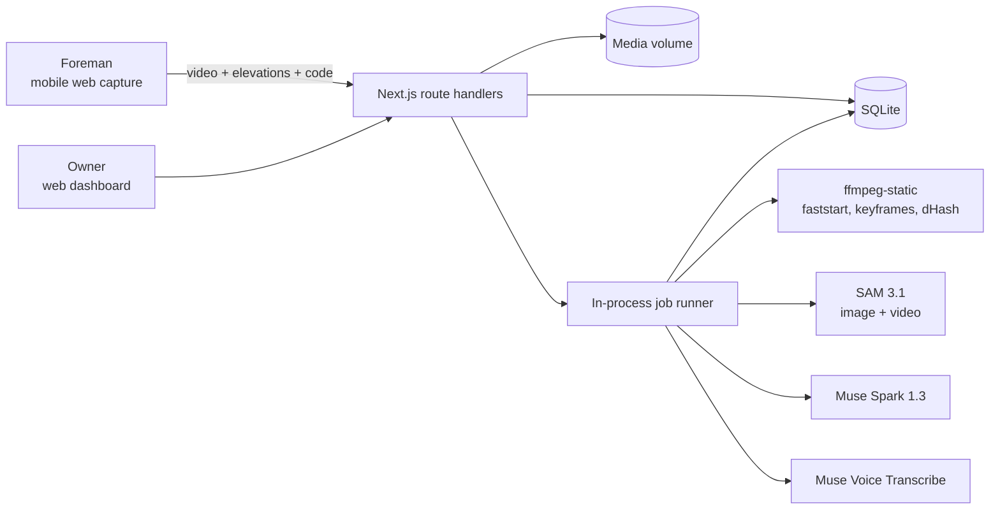

# Plumbline — Architecture

> The contractor's video becomes the receipt.

## Pitch

Nigerians abroad (and in Abuja or Lagos) build houses in their hometowns through a relative or a contractor they can't supervise. Proof of progress today is a WhatsApp photo, and the documented failure mode is years of photos of someone else's house. Plumbline turns a two-minute site visit into a count you can audit. The foreman films a guided walkthrough with a one-time visit code. SAM 3.1 counts blocks, columns, openings and block stacks with pixel masks. Muse Spark compares the result against the bill of quantities (BOQ) and the previous visit. The owner gets a per-milestone verdict ("Verified: 1,742 of 1,800 blocks") before releasing the next tranche.

**What makes it different:** enterprise tools (Buildots, OpenSpace, Roboflow) serve construction firms with 360° cameras and models trained per site. The diaspora services (BuildPanda, Track Your Build) rely on human inspectors and daily logs. Plumbline is the first that gives a homeowner a count produced by segmentation rather than an LLM's guess, with no training data, from a phone.

## Problem and sponsor fit

- **Who:** a diaspora owner funding a 3–4 bedroom bungalow in their home state, paying a contractor or relative in tranches.
- **Workaround today:** WhatsApp photos and video calls, occasional visits by a cousin, trust.
- **Cost:** a whole build budget. Documented cases include a brother sending photos of another person's house for 10 years ([Legit.ng](https://www.legit.ng/1212279-man-returns-nigeria-10-years-finds-brother-lied-building-a-duplex-him.html)) and family embezzling project funds for 6 years ([Gistreel](https://www.gistreel.com/betrayed-for-6-years-nigerian-man-heartbroken-as-he-discovers-family-embezzled-house-project-funds/)). Ownkey's guidance says to demand live video walkthroughs and to watch for "the same angle" repeating ([Ownkey](https://ownkey.com/ng/blog/building-house-nigeria-from-abroad-avoid-contractor-fraud)).
- **Sponsor removal test:** without SAM 3.1, counts become an LLM's estimate (LLMs are poor counters, and we measure this in `docs/evidence/counting-eval.md`). Without Muse Spark, nothing maps the counts to the BOQ, judges the build stage, or decides whether this is the same site as last visit. The core flow stops working.

### Capability map

| User flow | What happens | Meta model / call |
|---|---|---|
| Owner sets milestones from a BOQ | BOQ PDF → structured milestone targets (blocks, columns, openings) | Muse Spark 1.3, `POST /v1/responses`, PDF input, JSON schema output |
| Foreman proves the visit is live | One-time code written on a block / held to camera and spoken | Muse Spark 1.3 (frames: is code `K74Q` visible?) + Muse Voice Transcribe `POST /v1/asr/transcribe` (spoken code, English) |
| Count laid blocks per elevation | Still per wall face → instance masks → count | SAM 3.1 image, `POST /v1/responses`, prompt `"concrete block"` |
| Count columns, openings, block stacks | Walkthrough video → identity-tracked objects, each counted once | SAM 3.1 video, `POST /v1/responses`, `input_video` via Files API, tracking |
| Same site as last time? What changed? | Baseline frames vs this visit's frames | Muse Spark 1.3, multi-image input |
| Stage verdict against milestone | Counts + frames + BOQ → verdict and gaps | Muse Spark 1.3, structured output |

Our own deterministic code: the area cross-check (wall-mask area ÷ median block-face area vs instance count), perceptual-hash reuse detection across visits, and the milestone release rule.

## System overview

## Components

- **Web app (Next.js 15, App Router):** the owner dashboard (projects, milestones, visit reports with mask overlays) and a mobile-first foreman capture flow. Both are one deploy.
- **Route handlers:** project/milestone CRUD, visit-code issue, media upload, visit status (polled).
- **Job runner:** in-process queue that runs the verification pipeline per visit. Each step writes its own status row, so the UI shows named steps instead of one spinner.
- **`src/lib/meta/`:** thin clients for SAM (`segmentImage`, `trackVideo` using `@meta-sam/parser`), Spark (`assessStage`, `extractMilestones`, `checkCode`, `compareSites`) and ASR (`transcribe`). These are the only places that talk to Meta. The e2e script and the app share them.
- **`src/lib/verify/`:** pure functions for the area cross-check, reuse hashing, and verdict rules, all unit-tested.

## Data model

- `project`: id, name, location, owner name, baseline_visit_id, boq_file, created_at
- `milestone`: id, project_id, title, kind (`blocks|columns|openings|stage`), target, tranche_ngn, status (`open|verified|short|review`)
- `visit`: id, project_id, code, code_issued_at, code_expires_at, submitted_at, status
- `media`: id, visit_id, kind (`walkthrough|elevation`), label (`front|left|back|right`), path, sha256, dhash
- `step`: visit_id, name (`liveness|reuse|site_match|count_elevations|track_walkthrough|cross_check|stage_assessment|verdict`), status (`pending|running|passed|failed|review`), detail_json, started_at, finished_at
- `count`: visit_id, media_id, object (`block|column|opening|stack`), n, method (`sam_instances|sam_track|area_estimate|spark_guess`), confidence, overlay_path

## Key flows (the demo)

1. **Visit with a live code.** Foreman opens the capture link → gets code `K74Q` (valid 30 min) → writes it on a block → films a 60–90 s walkthrough and four elevation stills → uploads. Pipeline: liveness ✓ → reuse ✓ → site match ✓ → counts → cross-check → verdict.
2. **The count you can audit.** On the owner's report, each elevation shows the SAM masks numbered 1…n, alongside the instance count, the area estimate, and whether they agree. Tracked columns and openings in the walkthrough replay with stable IDs.
3. **The lie gets caught.** Resubmitting last week's footage fails the reuse step, another site's photos fail site match, and a missing code fails liveness. The tranche stays locked and the report says exactly why.

## Stack choices

- **Next.js + TypeScript:** one deploy for both the dashboard and the capture flow, and the playbook default.
- **SQLite (`better-sqlite3`) + a media volume on one container:** SAM video streams and Spark calls can run for minutes, which doesn't fit serverless time limits. One long-lived Node process with a disk is the simplest thing that works.
- **`ffmpeg-static`:** MP4 faststart remux (SAM requirement), keyframe extraction, frame hashes. No system ffmpeg needed.
- **Deploy:** Docker on Railway (or Fly) with a volume.
- **SAM limits that shaped the design:** video tracking caps at 16 objects per frame, so walls are counted from stills in image mode, and video is used only for sparse objects (columns, openings, stacks). Video must be MP4/MOV with H.264/H.265, up to 15,000 frames.

## Out of scope

- Moving money. We record a release recommendation per milestone; no payment rail.
- Accounts and auth beyond unguessable project/capture links.
- Native mobile apps, offline capture, multi-language UI.
- Structural engineering judgement (rebar spacing, concrete strength). We count and compare; we don't certify safety.

## Milestones

| # | Target date | Ships |
|---|---|---|
| M1 | Oct 30 | SAM spike on real block-wall stills; upload one elevation → instance count + numbered mask overlay + area cross-check. Deployed. |
| M2 | Oct 31 | Visit capture flow (code, walkthrough, 4 elevations); video tracking for columns/openings/stacks; named pipeline steps persisted and polled. |
| M3 | Nov 1 | Muse Spark: BOQ → milestones, liveness code check, site match, stage assessment; ASR spoken-code check. |
| M4 | Nov 2 | Owner report + milestone verdicts; reuse detection; seeded demo project; `npm run e2e` with evidence. |
| M5 | Nov 3 | Counting eval (SAM vs hand count vs Spark-only), README, demo script; record on Nov 4 morning, submit by Nov 4 12:00 ET. |
