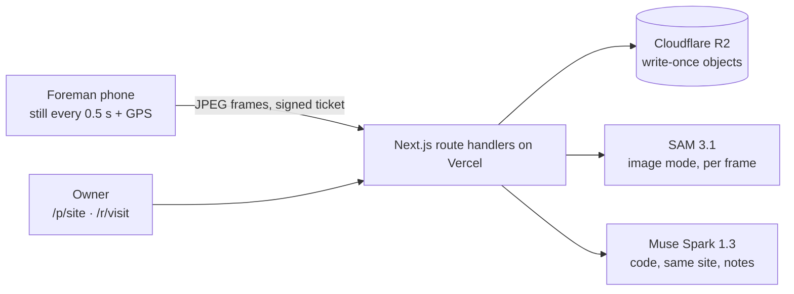
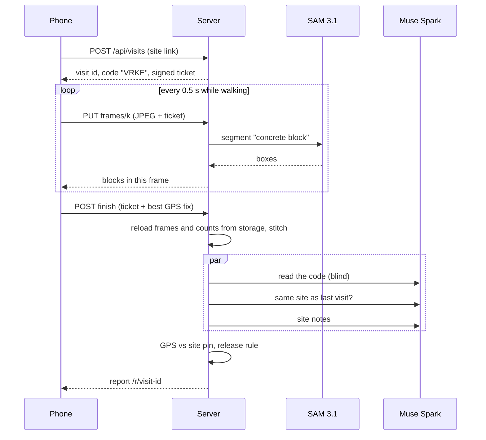

# Plumbline — Architecture

> The contractor's video becomes the receipt.

## Pitch

Nigerians abroad (and in Abuja or Lagos) build houses in their hometowns through a relative or a contractor they can't supervise. Proof of progress today is a WhatsApp photo, and the documented failure mode is years of photos of someone else's house. Plumbline turns a phone walk along a wall into a block count you can audit. The foreman writes a one-time code on a block, films it, and walks the wall; the phone sends a still every half second instead of a video. SAM 3.1 finds every block in every still while the walk is happening, our stitching joins the stills into one wall so each block counts once, and Muse Spark reads the code blind, checks it's the same site as last time and writes site notes. The owner gets a verdict per milestone ("Verified: 236 of 230 blocks confirmed") before releasing the next payment.

**What makes it different:** enterprise tools (Buildots, OpenSpace, Roboflow) serve construction firms with 360° cameras and per-site models. The diaspora services (BuildPanda, Track Your Build) rely on human inspectors and daily logs. Plumbline gives a homeowner a count produced by segmentation rather than an LLM's guess, from an ordinary phone, with no training data and no app install.

## Problem and sponsor fit

- **Who:** a diaspora owner funding a 3–4 bedroom bungalow in their home state, paying a contractor or relative in tranches.
- **Workaround today:** WhatsApp photos and video calls, occasional visits by a cousin, trust.
- **Cost:** a whole build budget. Documented cases include a brother sending photos of another person's house for 10 years ([Legit.ng](https://www.legit.ng/1212279-man-returns-nigeria-10-years-finds-brother-lied-building-a-duplex-him.html)) and family embezzling project funds for 6 years ([Gistreel](https://www.gistreel.com/betrayed-for-6-years-nigerian-man-heartbroken-as-he-discovers-family-embezzled-house-project-funds/)). Ownkey's guidance says to demand live video walkthroughs and to watch for "the same angle" repeating ([Ownkey](https://ownkey.com/ng/blog/building-house-nigeria-from-abroad-avoid-contractor-fraud)).
- **Sponsor removal test:** without SAM 3.1 there is no count, only an estimate; the stitching has nothing to merge. Without Muse Spark nothing proves the walk was filmed today for this visit (the blind code read), nothing notices a different site, and the owner gets numbers without context. The core flow stops working.

### Capability map

| User flow | What happens | Meta model / call |
|---|---|---|
| Count blocks while the foreman walks | Each still → instance boxes → count, as it arrives | SAM 3.1 image mode, `POST /v1/responses`, model `sam-3.1`, prompt `"concrete block"` (`src/lib/meta/sam.ts`) |
| Prove the walk is today's | Opening frames → the code written on a block, read without being told what to expect | Muse Spark 1.3, `POST /v1/responses`, multi-image input, JSON reply (`src/lib/pipeline/liveness.ts`) |
| Same site as last time? | A mid-walk frame from this visit and the last one → compare fixed landmarks | Muse Spark 1.3, two images (`src/lib/pipeline/site-notes.ts`) |
| What should the owner know? | Four frames spread along the walk → stage, visible defects with frame numbers, plain summary | Muse Spark 1.3, four images (`src/lib/pipeline/site-notes.ts`) |

Our own deterministic code (`src/lib/verify/`, unit-tested): frame-to-frame shift estimation and sighting merge (stitching), the close-up filter, GPS distance to the site pin, and the release rule.

## System overview

The phone never uploads a video. It grabs a still every half second (shortest side 540 px, JPEG) and sends each as its own small request. That keeps every request under serverless limits, keeps mobile data bounded, and lets SAM count while the walk is still happening. Measured: a 31 s walk of the test clip is 9.3 MB of stills against 29 MB for the 540p video and 94 MB as recorded; real phone walks on rough concrete ran about 310 KB a still at JPEG quality 0.82 (33.1 MB for 53 s); at 0.75 the same walk is 17.6 MB, with the count within about 1% (see `docs/build-log.md`).

## Components

- **Web app (Next.js 15, App Router):**
  - `/` home, with a replay of a real counted walk (`public/showcase`, built by `npm run showcase`).
  - `/new` set up a test site (name, block target, payment).
  - `/p/<token>` the owner's site page: foreman link with QR and WhatsApp share, every visit with its verdict.
  - `/v/<token>` the foreman's capture flow: code, full-screen camera with live block count, processing with named steps, receipt.
  - `/r/<visit-id>` the shareable report: verdict, checks, site notes, the stitched wall with every block numbered.
- **`/api/visits`:** issues a signed ticket (visit id, one-time code, expiry, HMAC). No database: every later call is checked against the signature.
- **`/api/visits/<id>/frames/<k>`:** receives one JPEG, stores it, runs SAM 3.1, stores the boxes, returns the count (limits: 240 frames, 1.5 MB each).
- **`/api/visits/<id>/finish`:** reloads frames and counts from storage (never from the phone), stitches, runs the three Muse Spark calls in parallel with each other, checks GPS against the site pin, applies the release rule, writes the report and a line in the site's history.
- **`/api/projects`:** creates a test site from the `/new` form.
- **`src/lib/meta/`:** the only code that talks to Meta. **`src/lib/verify/`:** pure functions, unit-tested. **`src/lib/pipeline/`:** the visit pipeline.

## Data model

No database. The demo site is code (`src/lib/projects.ts`); everything else is one write-once object in Cloudflare R2 (a local folder in dev):

- `projects/<id>/project.json`: a test site made on `/new`
- `projects/<id>/pin.json`: the site pin, set by the first visit with a precise GPS fix and a readable code
- `projects/<id>/visits/<visit-id>.json`: one line of the site's history
- `visits/<id>/meta.json`: ticket plus project and milestone text
- `visits/<id>/frames/0000.jpg ...`: stills
- `visits/<id>/sam/0000.json ...`: SAM boxes per still
- `visits/<id>/result.json`: stitched blocks, checks, site notes, verdict

## Release rule

`decide()` in `src/lib/pipeline/verdict.ts`, in order:

1. Code not read (or more than one character off) → **not verified**, whatever the count.
2. Confirmed (seen in 2+ stills) ≥ target → **verified**, or **review** if the code was one character off.
3. Confirmed + seen-once ≥ target → **review** (a person checks the seen-once blocks).
4. Otherwise → **short**.
5. Any held check (GPS far from the pin or missing, Spark says a different site) turns **verified** into **review**. Holds never soften short or not verified.

Site notes never change the verdict.

## Key flows (the demo)

1. **A visit with a live code.** Owner sends the foreman link → foreman gets code `VRKE` (valid 30 min) → writes it on paper or a block → films it, then walks the wall while the live count climbs → report in about a minute.
2. **The count you can audit.** The report lays every still on one wall and numbers each block; solid means seen in two or more stills, amber means seen once and needs an eye.
3. **The lie gets caught.** A hand-written Q read as P held a real visit; an old video can't carry today's code; a walk filmed away from the site pin, or at a different site, can't be verified.

## Stack choices

- **Next.js + TypeScript on Vercel's free plan:** one deploy for capture, reports and API.
- **Stills, not video, from the phone:** a 30–90 MB video can't pass through a function (about 4.5 MB request limit) and costs data. Stills let counting run live.
- **Cloudflare R2, no database:** the only state is write-once objects; the signed ticket replaces a visit table.
- **Pure-JS JPEG decode (`jpeg-js`), no ffmpeg on the server:** stitching needs only small grey copies. `ffmpeg-static` is a dev dependency for scripts.
- **SAM image mode for every count:** video tracking caps at 16 objects per frame and took 4–30 minutes per prompt on a 31 s clip (see `docs/build-log.md`).

## Out of scope

- Moving money. The report records a release recommendation per milestone; no payment rail.
- Accounts. Sites and reports are protected only by unguessable links; on a test site the foreman link and the owner page share one key.
- GPS integrity. The fix comes from the phone and can be spoofed; it catches the lazy fake, not a determined one.
- Bill of quantities parsing, spoken codes (Muse Voice has no Yoruba, Hausa, Igbo or Pidgin), columns and openings in the walk count, native apps, offline capture.
- Structural judgement. We count and compare; we don't certify safety.

## Milestones

| # | Date | Shipped |
|---|---|---|
| M1 | Oct 29 | SAM spike on real block-wall stills; video tracking ruled out; walk-along stitching built and measured. |
| M2 | Oct 29–30 | Foreman capture flow (code, camera, live count), stills to Vercel Blob, signed tickets, report with stitched wall. Deployed. |
| M3 | Oct 30 | First phone walks on the live app; close-up filter; iOS camera fixes. |
| M4 | Oct 30 | GPS site pin, Muse Spark same-site check and site notes, test sites, owner timeline, home page replay. |
| M5 | Oct 31–Nov 1 | Karsana walk (372 blocks, GPS pin); storage moved to Cloudflare R2 after the Blob free cap; stills at quality 0.75; replay attack tested on the live app (not verified); demo video. |
| M6 | Nov 1–4 | Hand count of the Karsana wall (340 blocks) against the report's 372, recorded in the README; submit by Nov 4 12:00 ET. |
