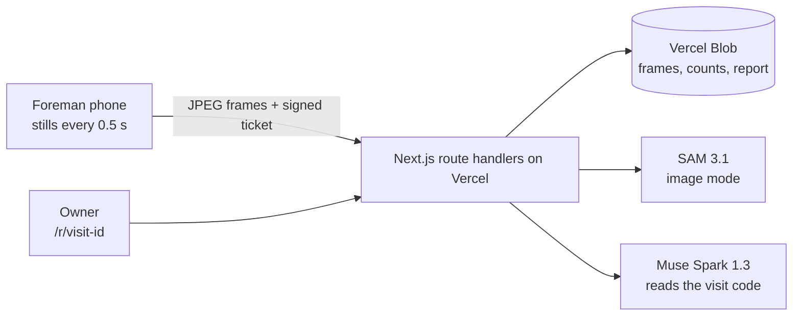

# Plumbline — Architecture

> The contractor's video becomes the receipt.

## Pitch

Nigerians abroad (and in Abuja or Lagos) build houses in their hometowns through a relative or a contractor they can't supervise. Proof of progress today is a WhatsApp photo, and the documented failure mode is years of photos of someone else's house. Plumbline turns a two-minute site visit into a count you can audit. The foreman walks the wall with a one-time visit code and the phone sends stills, not video. SAM 3.1 counts blocks, columns, openings and block stacks with pixel masks. Muse Spark compares the result against the bill of quantities (BOQ) and the previous visit. The owner gets a per-milestone verdict ("Verified: 1,742 of 1,800 blocks") before releasing the next tranche.

**What makes it different:** enterprise tools (Buildots, OpenSpace, Roboflow) serve construction firms with 360° cameras and models trained per site. The diaspora services (BuildPanda, Track Your Build) rely on human inspectors and daily logs. Plumbline is the first that gives a homeowner a count produced by segmentation rather than an LLM's guess, with no training data, from a phone.

## Problem and sponsor fit

- **Who:** a diaspora owner funding a 3–4 bedroom bungalow in their home state, paying a contractor or relative in tranches.
- **Workaround today:** WhatsApp photos and video calls, occasional visits by a cousin, trust.
- **Cost:** a whole build budget. Documented cases include a brother sending photos of another person's house for 10 years ([Legit.ng](https://www.legit.ng/1212279-man-returns-nigeria-10-years-finds-brother-lied-building-a-duplex-him.html)) and family embezzling project funds for 6 years ([Gistreel](https://www.gistreel.com/betrayed-for-6-years-nigerian-man-heartbroken-as-he-discovers-family-embezzled-house-project-funds/)). Ownkey's guidance says to demand live video walkthroughs and to watch for "the same angle" repeating ([Ownkey](https://ownkey.com/ng/blog/building-house-nigeria-from-abroad-avoid-contractor-fraud)).
- **Sponsor removal test:** without SAM 3.1, counts become an LLM's estimate (LLMs are poor counters, and we measure this in `docs/evidence/counting-eval.md`). Without Muse Spark, nothing maps the counts to the BOQ, judges the build stage, or decides whether this is the same site as last visit. The core flow stops working.

### Capability map

| User flow | What happens | Meta model / call |
|---|---|---|
| Owner sets milestones from a BOQ | BOQ PDF → structured milestone targets (blocks, columns, openings) | Muse Spark 1.3, `POST /v1/responses`, PDF input, JSON schema output |
| Foreman proves the visit is live | One-time code written on a block / held to camera and spoken | Muse Spark 1.3 (frames: is code `K74Q` visible?) + Muse Voice Transcribe `POST /v1/asr/transcribe` (spoken code, English) |
| Count laid blocks per elevation | Still per wall face → instance masks → count | SAM 3.1 image, `POST /v1/responses`, prompt `"concrete block"` |
| Count openings (vents, windows, doors) and pillars per elevation | Straight-on stills or keyframes pulled from the walkthrough → instance masks | SAM 3.1 image, prompts such as `"hollow block opening"`, `"vertical concrete column"` |
| Continuity track over the walkthrough (optional, precomputed) | Walkthrough video → blocks keep their identity across frames | SAM 3.1 video, `input_video` via Files API |
| Same site as last time? What changed? | Baseline frames vs this visit's frames | Muse Spark 1.3, multi-image input |
| Stage verdict against milestone | Counts + frames + BOQ → verdict and gaps | Muse Spark 1.3, structured output |

Our own deterministic code: the area cross-check (wall-mask area ÷ median block-face area vs instance count), perceptual-hash reuse detection across visits, and the milestone release rule.

## System overview

The phone never uploads a video. It grabs a still every half second while the foreman walks (shortest side 540 px, JPEG), and each frame is sent as its own small request. A 31 s walk is about 9 MB, against 29 MB for the same video shrunk to 540p and 94 MB as the phone recorded it. That keeps every request under serverless limits, keeps mobile data use low (data is expensive in Nigeria, and a cap on size also caps abuse and cost), and lets SAM count while the walk is still happening.

## Components

- **Web app (Next.js 15, App Router):** `/v/<token>` the foreman's capture flow, `/r/<visit-id>` the shareable owner report (anyone with the link can read it; the id is unguessable).
- **`/api/visits`:** issues a signed ticket (visit id, one-time code, expiry, HMAC). No database: every later call is checked against the signature.
- **`/api/visits/<id>/frames/<k>`:** receives one JPEG, stores it, runs SAM 3.1 `"concrete block"`, stores the boxes, returns the count (limits: 240 frames, 1.5 MB each).
- **`/api/visits/<id>/finish`:** reads frames and counts back from storage (never from the phone), decodes small grey copies in plain JavaScript, estimates the shift between frames, merges sightings into unique blocks, asks Muse Spark to read the visit code blind, applies the release rule, writes the report.
- **`src/lib/meta/`:** the only code that talks to Meta. **`src/lib/verify/`:** pure functions (stitching, area cross-check, release rule), unit-tested.

## Data model

No database. Projects and milestones are code (`src/lib/projects.ts`). Everything a visit produces is one write-once object in Vercel Blob (local folder in dev):

- `visits/<id>/meta.json`: ticket plus project and milestone text
- `visits/<id>/frames/0000.jpg ...`: keyframes
- `visits/<id>/sam/0000.json ...`: SAM boxes per frame
- `visits/<id>/result.json`: stitched blocks, code check, verdict

## Key flows (the demo)

1. **Visit with a live code.** Foreman opens the capture link → gets code `K74Q` (valid 30 min) → writes it on a block → films a 60–90 s walkthrough and four elevation stills → uploads. Pipeline: liveness ✓ → reuse ✓ → site match ✓ → counts → cross-check → verdict.
2. **The count you can audit.** On the owner's report, each elevation shows the SAM masks numbered 1…n, alongside the instance count, the area estimate, and whether they agree. Openings and pillars are counted per elevation still. The walkthrough replay with tracked blocks is a continuity view, precomputed rather than run live.
3. **The lie gets caught.** Resubmitting last week's footage fails the reuse step, another site's photos fail site match, and a missing code fails liveness. The tranche stays locked and the report says exactly why.

## Stack choices

- **Next.js + TypeScript on Vercel's free plan:** one deploy for the capture flow, report and API.
- **Stills, not video, from the phone:** a 30 to 90 MB video can't pass through a function (about 4.5 MB request limit) and costs data. Stills are about 9 MB for a 31 s walk and let counting run live.
- **Vercel Blob, no database:** the only state is write-once files; the signed ticket replaces a visit table.
- **Pure-JS JPEG decode (`jpeg-js`), no ffmpeg on the server:** the stitching needs only small grey frames. `ffmpeg-static` stays as a dev dependency for the local scripts.
- **SAM image mode for every count:** video tracking caps at 16 objects per frame and took 4 to 30 minutes per prompt on a 31 s clip (see `docs/build-log.md`).

## Out of scope

- Moving money. We record a release recommendation per milestone; no payment rail.
- Accounts and auth beyond unguessable project/capture links.
- Native mobile apps, offline capture, multi-language UI.
- Structural engineering judgement (rebar spacing, concrete strength). We count and compare; we don't certify safety.

## Milestones

| # | Target date | Ships |
|---|---|---|
| M1 | Oct 30 | SAM spike on real block-wall stills; upload one elevation → instance count + numbered mask overlay + area cross-check. Deployed. |
| M2 | Oct 31 | Visit capture flow (code, walkthrough, 4 elevations); video tracking for columns/openings/stacks; named pipeline steps persisted and polled. |
| M3 | Nov 1 | Muse Spark: BOQ → milestones, liveness code check, site match, stage assessment; ASR spoken-code check. |
| M4 | Nov 2 | Owner report + milestone verdicts; reuse detection; seeded demo project; `npm run e2e` with evidence. |
| M5 | Nov 3 | Counting eval (SAM vs hand count vs Spark-only), README, demo script; record on Nov 4 morning, submit by Nov 4 12:00 ET. |
