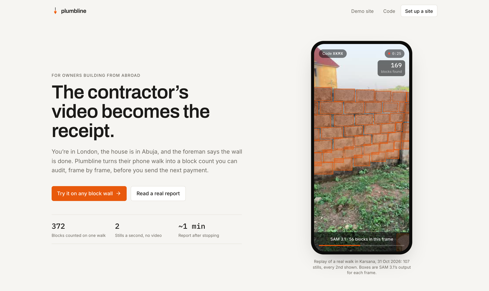
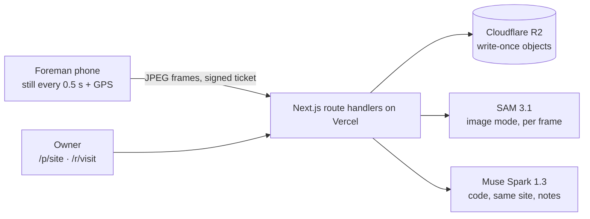
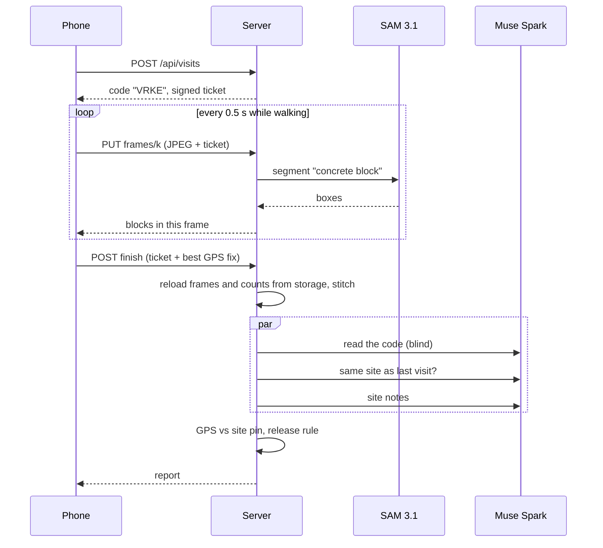

# Plumbline



   [](https://plumbline-ruby.vercel.app)

### The contractor's video becomes the receipt.

For Nigerians abroad building a house back home through a foreman they can't supervise. The foreman walks the wall with a one-time code on a phone; SAM 3.1 finds every block in every still while they walk, our stitching counts each block once, and Muse Spark reads the code blind, checks it's the same site as last time and writes site notes. Every number on a report comes from a real Meta API call on real frames, and you can open each frame.

**[Watch the demo](#demo)** · **[Live app](https://plumbline-ruby.vercel.app)** · **[Verify it yourself](#verify-it-yourself-in-90-seconds)** · **[Architecture](ARCHITECTURE.md)** · **[Run it locally](#run-it-locally)**

## Demo

[](https://youtu.be/xlCYNuYCelE)

**[Watch on YouTube (2:56)](https://youtu.be/xlCYNuYCelE).** A real 53 s walk in Karsana, Abuja (372 blocks, verified), the report it produced, then that same recording fed into a new visit as the camera, which comes back "Not verified". Every scene is labelled in the corner: live app, live report, screenshots from the phone, or a replay of the stored walk. Sped-up parts say so on screen (the walk replay at 1.9×, the replay attack at 7× and 32×). Shot list and narration: [docs/demo-script.md](docs/demo-script.md).

## Verify it yourself in 90 seconds

**On the live app, with a phone and any block wall:**

1. Open [plumbline-ruby.vercel.app/new](https://plumbline-ruby.vercel.app/new), set a block target (rows × blocks per row) and create the site.
2. Scan the QR on the site page with your phone. Allow camera and location.
3. Write the 4-character code on paper, film it for two seconds, then walk slowly along the wall for 20–40 s.
4. The report is ready about a minute after you stop. Open any frame, count the numbered blocks yourself.

**Or read the reports from our walks:** [372 confirmed on a 53 s fence walk](https://plumbline-ruby.vercel.app/r/vis_55dbb8c2d7d2) · [236 confirmed, verified](https://plumbline-ruby.vercel.app/r/vis_77d1c43227e3) · [the demo site's history](https://plumbline-ruby.vercel.app/p/demo)

**From the repo:**

```sh
npm install
npm test
# tests 21
# pass 21
# fail 0

cp .env.example .env.local        # add MODEL_API_KEY
npm run dev -- -p 3100 &
npm run e2e -- fixtures/your-walk.mp4 http://localhost:3100
# drives the phone's HTTP calls against the real Meta APIs; prints the verdict and writes docs/evidence/e2e/
```

| Measured | Value | Where |
|---|---|---|
| Blocks on a 53 s phone walk, GPS ±2 m | 372 stitched and confirmed (+45 seen once); our estimate of the actual wall is about 330 (300–360), see [How close is the count?](#how-close-is-the-count); code read, verified | [vis_55dbb8c2d7d2](https://plumbline-ruby.vercel.app/r/vis_55dbb8c2d7d2) |
| Blocks confirmed on a 58 s phone walk | 236 (+21 seen once), code read, verified | [vis_77d1c43227e3](https://plumbline-ruby.vercel.app/r/vis_77d1c43227e3) |
| Double counts removed by the close-up filter, replayed on a real walk | 12 (245 → 239 confirmed) | [build log](docs/build-log.md) (that report was lost in the storage move) |
| Test clip: stills sent vs the same video | 9.3 MB vs 29 MB (540p) vs 94 MB (as recorded) | [docs/evidence/e2e](docs/evidence/e2e) |
| Yesterday's walk fed into a new visit as the camera | Not verified: `Read "XKMX", expected "47TU"` (353 blocks still counted) | [vis_7ef2922f3dfd](https://plumbline-ruby.vercel.app/r/vis_7ef2922f3dfd) |
| JPEG quality 0.82 → 0.75 on the 53 s walk | 33.1 → 17.7 MB, 372 → 367 confirmed | [build log](docs/build-log.md) |
| End to end through the HTTP API on production (Cloudflare R2), 63 stills | 102 s, 225 confirmed + 15 seen once; the test clip has no visit code, so not verified, as it should be | [vis_67c0f5b7ac38](https://plumbline-ruby.vercel.app/r/vis_67c0f5b7ac38), `npm run e2e` |

## Contents

[The problem](#the-problem) · [What it does](#what-it-does) · [Architecture](#architecture) · [The hard problem](#the-hard-problem-the-wall-that-counted-itself-twice) · [How close is the count?](#how-close-is-the-count) · [Real vs simplified](#whats-real-vs-simplified) · [Decisions](#engineering-decisions) · [Layout](#project-layout) · [Run it locally](#run-it-locally) · [Limitations](#known-limitations-and-disclosure)

## The problem

Picture a nurse in Manchester paying a cousin in Kuje, Abuja to build a bungalow in tranches. Proof of progress is a WhatsApp photo. The failure mode is documented: a brother sent photos of another man's house for ten years ([Legit.ng](https://www.legit.ng/1212279-man-returns-nigeria-10-years-finds-brother-lied-building-a-duplex-him.html)); a family spent six years of project funds ([Gistreel](https://www.gistreel.com/betrayed-for-6-years-nigerian-man-heartbroken-as-he-discovers-family-embezzled-house-project-funds/)). The standard advice is to demand live video walkthroughs ([Ownkey](https://ownkey.com/ng/blog/building-house-nigeria-from-abroad-avoid-contractor-fraud)), but a video doesn't tell you whether there are 230 blocks in the wall or 140, and an owner can't count them from Manchester.

Take SAM 3.1 out and there is no count, only a guess. Take Muse Spark out and nothing proves the walk is today's, nothing notices it's a different site, and the owner gets numbers with no context.

## What it does

| Capability | What the user does | Meta calls behind it |
|---|---|---|
| Live block count | Foreman walks the wall; a still goes up every 0.5 s and the count climbs on screen | SAM 3.1 image mode per still, `POST /v1/responses`, prompt `"concrete block"` |
| One wall, each block once | Nothing: the report shows every still laid on one wall with every block numbered | Our stitching over SAM's boxes (`src/lib/verify/stitch.ts`) |
| Proof the walk is today's | Writes a one-time code on a block and films it first | Muse Spark 1.3 reads the code blind from the opening frames |
| Same site as last time | Nothing | Muse Spark 1.3 compares landmarks in one frame from each visit |
| Site notes | Owner reads them on the report, each tied to a frame | Muse Spark 1.3 over four frames spread along the walk |
| Filmed at the site | Allows location on the phone | Phone GPS against the site pin (first located visit sets it) |
| Owner timeline and links | Owner sets up a site, shares the foreman link by QR or WhatsApp | none (write-once storage) |

## Architecture





| Module | Role |
|---|---|
| `src/lib/meta/` | The only code that calls Meta: OpenAI SDK pointed at `https://api.meta.ai/v1`, SAM output parsed with `@meta-sam/parser` |
| `src/lib/verify/stitch.ts` | Shift between stills, sighting merge, close-up filter (pure, tested) |
| `src/lib/verify/geo.ts` | Distance to the site pin (pure, tested) |
| `src/lib/pipeline/verdict.ts` | The release rule (pure, tested) |
| `src/lib/pipeline/liveness.ts`, `site-notes.ts` | The three Muse Spark calls |
| `src/lib/pipeline/visit.ts` | Store a still and count it; finish a visit |
| `src/lib/ticket.ts` | Signed visit tickets instead of a database |

More in [ARCHITECTURE.md](ARCHITECTURE.md).

## The hard problem: the wall that counted itself twice

The obvious way to count blocks along a walk is SAM 3.1's video mode: track every block across the clip and count the tracks. We tried it first. Video tracking locks onto at most 16 objects, all chosen in the first frame, and took 4 to 30 minutes per prompt on a 31 s clip. A wall has hundreds of blocks.

So the phone sends stills and SAM counts each one. That moves the problem: block 37 appears in six stills, and summing per-still counts gives a number six times too big. We estimate how far the wall slid between neighbouring stills (brute-force image matching on small grey copies), place every block on one shared wall, and merge sightings that land on the same spot. A block seen in two or more stills is confirmed; seen once goes to a person. Boxes cut off by the frame edge are skipped because the block appears whole in a neighbour.

Then the first real walk taught us something the test clip didn't. Foremen film the code up close and step back before walking. In those stills the blocks are drawn two to six times bigger, the stitching (which assumes a sideways slide, no zoom) put them in the wrong place, and the same blocks were counted twice. Replaying that walk locally, through the same code and the same SAM calls, the close-up filter (keep only stills whose median block height is within 1.35× of the walk's typical height) removed 12 double counts: 245 → 239 confirmed.

Guarded by `src/lib/verify/stitch.test.ts` (shift recovery, edge-box skip, same-still boxes never merge, close-ups dropped) and `npm run replay`.

## How close is the count?

We haven't hand-counted the Karsana wall, so there is no ground truth to quote. What we can say, from the stored data of that one walk (`vis_55dbb8c2d7d2`):

| Estimate | How | Blocks |
|---|---|---|
| Stitched and confirmed | Every block SAM found, placed on one wall, each seen in 2+ stills (what the report shows) | 372 (+45 seen once) |
| Duplicates merged | Boxes that overlap another by more than 30%, or sit mostly inside one, treated as the same block | 357 (334 seen in 2+ stills) |
| Wall geometry | The stitched wall is about 47 blocks long (3,420 px at 69 px per block with joint) and 5 to 9 courses high, typically 6 to 7 | 305 to 330 |

Our fair reading is **about 330 blocks, within 300 to 360**: the stitched count runs about 10% high, mostly in the middle stretch, where the foreman stood further back and grass filled the lower half of each still, so about 40 pairs of boxes overlap. SAM also skips some dirty blocks (about 6% on our test stills), which pulls the other way. The verdict doesn't turn on it: the milestone target was 100, and every estimate is more than three times that. A hand count of this wall would replace the estimate with a measurement. Method and the fix we tested and held back: [build log](docs/build-log.md).

## What's real vs simplified

| Capability | How it's backed | Status |
|---|---|---|
| Block count | SAM 3.1 on every still, live, on the deployed app | Real |
| Stitching and merge | Our code; translation only, no rotation or zoom | Real, simplified geometry |
| Visit code check | Muse Spark reads blind, we compare | Real |
| Same-site check | Muse Spark on one frame per visit | Real; a judgement, not a measurement |
| Site notes | Muse Spark on four frames | Real; never changes the verdict |
| Location | Phone GPS vs the site pin | Real, but spoofable by a determined foreman |
| Payment release | A recommendation on the report | Not built: no payment rail |
| Accounts | Unguessable links only | Simplified |
| Columns, openings, bill of quantities, spoken codes | Explored in spikes, not in the product | Not built |
| Home page phone | A replay of visit `vis_55dbb8c2d7d2`: its stored stills, SAM boxes from a local re-count (373/45 vs the live 372/45), and its stored report | Real data, replayed |

## Engineering decisions

- **Stills, not video.** Vercel functions accept about 4.5 MB per request; a phone walk is 30–94 MB. Stills fit, cost less data in Nigeria, and let SAM count during the walk.
- **The server never trusts the phone's count.** `/finish` reloads every still and SAM result from storage and recomputes. The GPS fix is the one thing that comes from the phone, and the report says so.
- **The model reads the code blind.** Telling Muse Spark the expected code invites a polite "yes, I see VRKE". The code alphabet drops 0/O/Q and 1/I/L, after a real Q was read as P.
- **Seen once is not counted, only flagged.** SAM undercounts dirty or shaded blocks (about 94% recall on our stills) but doesn't invent them, so confirmed is a lower bound and seen-once goes to a person.
- **Held checks downgrade, never upgrade.** GPS or a different site can turn verified into review; nothing turns short into verified.
- **No database.** Every object is written once; a signed ticket replaces the visit table. Reports can't be edited after the fact, including ours.
- **Read by key, never by listing.** Our first store (Vercel Blob) counted every `list()` as a billable operation and paused us at the free cap mid-build. Storage moved to Cloudflare R2 behind the same one-file interface (`src/lib/storage.ts`), writes are guarded by `If-None-Match: *`, and only the site history lists. Two early reports were lost in the move and are marked as such.
- **Sharp edges routed around:** SAM output is special-token text, parsed with `@meta-sam/parser`; video mode's 16-object cap; iOS Safari ignoring `object-fit` on a camera stream; SAM giving slightly different boxes on a re-run (235/22 vs 236/21 on 117 stills). All in [docs/build-log.md](docs/build-log.md).

## Project layout

```
src/app/            pages (/, /new, /p, /v, /r) and API routes (/api/visits, /api/projects, /api/health)
src/components/     capture flow and camera, report, owner pages, home replay
src/lib/meta/       Meta API client, SAM image and video calls
src/lib/verify/     pure, tested logic: stitching, GPS, area cross-check
src/lib/pipeline/   per-still counting, Muse Spark checks, release rule, finishing a visit
src/lib/client/     in-browser frame capture, uploader, GPS watch
public/showcase/    the home page's replay: 54 stills of one real walk plus SAM's boxes for each (built by `npm run showcase`, committed because the site serves it as-is)
scripts/            spikes, e2e, replay of a stored visit, home page replay builder
docs/               build log, evidence, demo script, submission text
```

## Run it locally

Prerequisites: Node 20+, a Meta Model API key.

| Variable | Required | Description |
|---|---|---|
| `MODEL_API_KEY` | yes | Meta Model API key |
| `VISIT_SECRET` | in production | Signs visit tickets (`openssl rand -base64 32`) |
| `R2_BUCKET`, `R2_ACCOUNT_ID`, `R2_ACCESS_KEY_ID`, `R2_SECRET_ACCESS_KEY` | in production | Cloudflare R2 bucket (S3 API); without `R2_BUCKET`, objects go to `./data` |
| `DATA_DIR` | no | Local storage folder, default `./data` |

```sh
npm install
cp .env.example .env.local
npm run dev
```

Open `http://localhost:3000/new`, create a site, open its foreman link on a phone on the same network (camera access needs HTTPS or localhost; "Pick a video instead" works anywhere). Tests: `npm test` (21), `npm run typecheck`. Deploying: a Vercel project with `MODEL_API_KEY`, `VISIT_SECRET` and the four `R2_*` variables set (a Cloudflare R2 bucket and an API token with Object Read & Write on that bucket only). `/api/health` reports which are missing.

## Known limitations and disclosure

- Counts blocks in walls you walk along. Columns, openings, roofs and anything the camera can't see aren't counted.
- Stitching assumes you walk parallel to the wall. Turning a corner or walking at a steep angle can double count or miss; the close-up filter catches only the step back from the code.
- Counts are SAM's, checkable frame by frame on each report, not hand counts. On the Karsana walk we estimate the stitched count runs about 10% high (next section); we have not corrected the product for it.
- GPS can be spoofed; the visit code and same-site check carry more of the weight.
- Test sites and reports are public to anyone with the link.

Built for the Meta Global AI Developer Hackathon (Indie Developer track). First commit 2026-10-29; everything was built during the hackathon, starting from `create-next-app`. Not financial advice: a report is a recommendation, not a guarantee.
